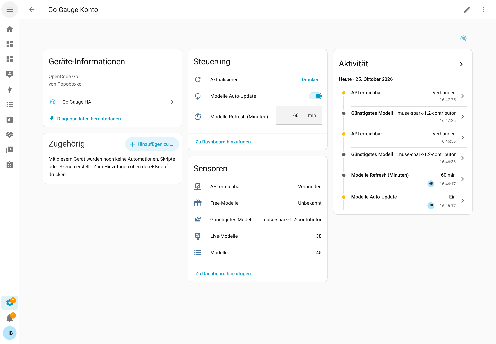

[English](README.md) | [Deutsch](README.de.md)

# Go Gauge HA

**Die Anzeige für dein OpenCode-Go-Budget — Nutzung, Limits & Kosten-Verhältnis direkt auf dem Dashboard.**

[](https://github.com/Popoboxxo/ha-go-gauge/releases) [](https://github.com/Popoboxxo/ha-go-gauge/actions/workflows/validate.yml) [](https://github.com/Popoboxxo/ha-go-gauge/actions/workflows/release-check.yml) [](https://hacs.xyz/docs/use/repositories/) [](https://www.home-assistant.io/) [](LICENSE) [](https://my.home-assistant.io/redirect/hacs_repository/?owner=Popoboxxo&repository=ha-go-gauge&category=integration)

Eigenständige [HACS](https://hacs.xyz)-Custom-Integration, die **direkt** gegen die
OpenCode-Go-API (`opencode.ai`) spricht — kein Monitor, kein Dashboard, keine
Zusatzkomponente. Nur dein Workspace-API-Token.

## Status

- Dieses Repository ist ein **HACS-Custom-Repository** und bewusst **nicht** im
  HACS-Default-Store/Katalog gelistet. Die Installation läuft über ein eigenes
  HACS-Repository (siehe [Installation](#installation)).
- Mindestversionen: Home Assistant **2026.8.0**, HACS **2.x**.
- Ab Home Assistant **2026.11** öffnet derselbe My-Link (`hacs_repository`) den
  Marketplace; der Link funktioniert vor und nach 2026.11.

## Features

- 🏷️ **Eine Workspace-Instanz pro Workspace** — sprechender Name + ein Token; mehrere
  Workspaces bedeuten mehrere Integrations-Instanzen (siehe
  [Mehrere Workspaces](#mehrere-workspaces))
- 🧾 **Genau eine Konto-Instanz** — wird beim ersten Workspace automatisch angelegt
  (`Go Gauge Konto`, `unique_id = go_gauge_account`), **nie manuell**: Modell-Katalog,
  Erreichbarkeit, die globalen Konto-Einstellungen (Katalog-Auto-Refresh + Intervall)
  und ein eigener Katalog-Refresh. Die Konto-Daten sind workspace-unabhängig und laufen
  weiter, auch wenn der letzte Workspace entfernt wird.
- 📈 **Prozentuale Nutzung** je Fenster (5h rolling / Weekly / Monthly)
- ⏰ **Konkrete Reset-Zeiten** als Timestamp-Entitäten — automationstauglich
- 🔮 **Prognose je Fenster**: lineare Hochrechnung der aktuellen Nutzung auf das
  Fensterende (kann über 100 % gehen — zeigt, ob das Tempo das Budget sprengt)
- 🧭 **Zwei Prognose-Methoden**: Ø-Pace (`percent × T / t`), sobald genug des Fensters
  verstrichen ist, davor ein Fallback über die gemessene Recent-Rate. Das Monatsfenster
  nutzt die **tatsächliche Kalendermonatlänge** aus `resetsAt` (28/29/30/31 Tage) statt
  nominaler 30 Tage. Forecast- und Pace-Sensoren liefern `forecast_recent`,
  `forecast_method`, `elapsed_fraction` und `window_seconds`.
- 🔥 **Konfigurierbarer Burn-Rate-Lookback** je Fenster (5h / Weekly / Monthly): drei
  Slider pro Workspace bestimmen, wie weit die Burn-Rate zurückschaut (Defaults **120** /
  **720** / **2880** min). Die Rate ist eine **OLS-Steigung** über alle Samples im
  Lookback und liefert `lookback_minutes`, `samples` und `lookback_too_short`. Ein
  **Reset Burn Lookbacks**-Button stellt genau diese drei Defaults wieder her.
- 🚦 **Pace-Ampel je Fenster**: `green`/`yellow`/`red` anhand der **primären Prognose** —
  Ø-Pace, sobald die Mindest-Einschaltzeit (max(15 min, 1 % des Fensters)) verstrichen ist,
  davor der Fallback über die Recent-Rate. Grenzen einstellbar über **Warning Threshold**
  (Grün/Gelb) und **Pace Red Limit** (Gelb/Rot, Default 100 %) — beides Number-Entities,
  live anpassbar
- 🚦 **Rate-Limit-Warnung** als Binary Sensor je Fenster + **Abo-Status** als eigener
  Binary Sensor (403 „EntitlementError" = kein aktives Abo, klar von einem
  Rate-Limit/Netzfehler unterschieden)
- 📦 **Modell-Katalog als EINEN Sensor** (`sensor.go_gauge_models` auf dem Konto-Gerät):
  komplettes, dynamisches Verzeichnis in den Attributen (`catalog_json`,
  `ranking_by_cost`, …) — neue Modelle erscheinen automatisch, ohne neue Entitäten.
- 🏆 Kompakt-Sensoren (Konto-Gerät): Live Models · Cheapest Model · Free Models
- 🛰️ **Evidenz-basierte Erreichbarkeit** — `api_reachable` (Konto-Gerät) ist ON bei
  mindestens einem frischen Erfolg, OFF nur bei ausschließlich frischen Fehlschlägen und
  `unknown`, wenn die API zwar antwortet, aber keinen Erfolg belegt (z. B. 401 oder kein
  Abo). „Frisch" heißt innerhalb der TTL: Katalog 2× Konto-Intervall (Fallback 120 min
  bei Auto-Refresh aus), Nutzung 3× Workspace-Intervall.
- 🔘 **Zwei Refresh-Buttons**: der Workspace-Button und der Konto-Button teilen den
  Translation-Key `refresh` und werden nur über ihr Gerät unterschieden — der
  Workspace-Button lädt **nur die Nutzung**, der Button auf dem Gerät „Go Gauge Konto"
  lädt **nur den Modell-Katalog**. Beide unabhängig von den Auto-Zyklen.
- ⚙️ **Getrennte Auto-Update-Zyklen**, live umschaltbar über eigene Switch-/Number-Entities
  (kein Neustart/Reload nötig) **oder** über die Optionen:

  | Zyklus | Ebene | Ein/Aus | Default |
  |--------|-------|---------|---------|
  | Nutzung (Usage) | Workspace | ✅ an | alle **10 Min** |
  | Modell-Katalog | Konto (global) | ✅ an | alle **60 Min** (1–1440 einstellbar) |

  Beide abschaltbar; dann aktualisiert nur der jeweilige Refresh-Button.
- 🔔 **Warning Threshold** (Default 80 %) als Number-Entity — live anpassbar, z. B. für
  eigene Automationen oberhalb des eingebauten Prozent-Sensors
- 🛟 **Offline-freundliches Setup**: Token wird beim Speichern live geprüft, aber bei
  Netzproblemen kannst du die Prüfung überspringen und trotzdem speichern. Schlägt der
  allererste Abruf beim HA-Start fehl, bricht das Setup nicht ab — HA versucht es im
  Hintergrund automatisch erneut.
- 🩺 **Tiefen-Diagnose**: Der Diagnostics-Export zeigt sofort Ursache und
  Handlungsempfehlung (z. B. „kein aktives Abo" vs. „Cloudflare-Rate-Limit"), ohne
  Rückfragen im Chat.

## Screenshot



Geräteseite „Go Gauge Konto" in Home Assistant — die Oberfläche ist auf Deutsch
abgebildet.

## Kompatibilität

| Komponente | Version |
|---|---|
| Home Assistant | **2026.8.0** oder neuer |
| HACS | **2.x** |
| Marketplace | ab Home Assistant **2026.11** über den My-Link (`hacs_repository`) — der Link funktioniert vor und nach 2026.11 |

## Installation

### My-Link

Der Button oben ([Open in HACS/Marketplace](https://my.home-assistant.io/redirect/hacs_repository/?owner=Popoboxxo&repository=ha-go-gauge&category=integration))
öffnet das Repository direkt in HACS (vor 2026.11) bzw. im Marketplace (ab 2026.11).

### Manuell als Custom-Repository

1. HACS → Integrations → ⋮ → *Custom repositories*
2. `https://github.com/Popoboxxo/ha-go-gauge` · Kategorie: `Integration`
3. Installieren → Home Assistant neu starten

### Manuell (Fallback)

Ordner `custom_components/go_gauge` nach `/config/custom_components/go_gauge` kopieren
und Home Assistant neu starten.

## Einrichtung

1. *Einstellungen → Geräte & Dienste → Integration hinzufügen* → **Go Gauge HA**
2. Sprechenden **Namen** für diesen Workspace vergeben (z. B. `Team`, `Privat`) sowie den
   OpenCode-Go-API-**Token** einfügen (Keys: OpenCode-UI → Workspace → Go → API Keys)
3. Optionen (Zahnrad auf dem Gerät) **oder** die Switch-/Number-Entities des Geräts:
   Nutzungs-Zyklus und Warning Threshold nach Geschmack einstellen. Die globalen
   Konto-Einstellungen (Katalog-Auto-Refresh + Intervall) liegen auf dem Konto-Gerät.

> **Cloudflare-Hinweis:** opencode.ai blockt Nicht-Browser-Agenten (HTTP 403 Error 1010).
> Die Integration sendet vollständige Browser-Header mit jeder Anfrage — eingebaut,
> nichts zu konfigurieren.

### Mehrere Workspaces

Jede Workspace-Instanz verwaltet genau **einen** Workspace (ein Name + ein Token).
Für weitere Workspaces die Integration einfach ein weiteres Mal hinzufügen, mit einem
eigenen Namen und Token.

Zusätzlich legt die Integration **automatisch genau eine Konto-Instanz** an
(`Go Gauge Konto`, `unique_id = go_gauge_account`) — beim ersten Workspace-Setup bzw.
beim nächsten Home-Assistant-Start. Sie ist **nicht** über „Integration hinzufügen"
erreichbar und darf **nie manuell** angelegt werden (sie wird über einen Import-Flow
erzeugt). Modell-Katalog, Erreichbarkeit und die globalen Konto-Einstellungen sind
workspace-unabhängig; sie laufen mit den eigenen Konto-Settings weiter, auch wenn der
letzte Workspace entfernt wird.

### Geräte

Pro Workspace-Instanz ein Gerät „Go Gauge {Workspace-Name}" (Nutzung, Forecast, Pace,
Reset-Zeiten, Warnschwelle/Pace-Rot-Grenze und Usage-Refresh-Intervall). Die
workspace-unabhängigen Entities (Model Catalog, Live Models, Cheapest Model, Free Models,
API Reachable) sowie der Katalog-Refresh-Button und die globalen Konto-Einstellungen
(Auto-Update Models, Models-Refresh-Intervall, Konto-Options-Flow) liegen auf dem
eigenen Gerät **„Go Gauge Konto"**. Dieses Gerät gehört der Konto-Entry, nicht einem
Workspace; es existiert genau einmal pro Home-Assistant-Instanz.

### Konto-Entry löschen/deaktivieren

Die Konto-Entry ist eine eigene Integrations-Instanz und wird automatisch verwaltet:

- **Löschen** (Geräte & Dienste → Go Gauge Konto → Löschen): Entities und Konto-Gerät
  verschwinden. Die Entry wird beim **nächsten** Workspace-Setup (Reload, Options-Änderung
  oder HA-Neustart) automatisch neu angelegt. War eine `entity_id` zuvor dedupliziert
  (`…_2`), kann die neu erzeugte Entity eine andere `entity_id` bekommen — die History
  bleibt in der Recorder-Datenbank, die Bindung läuft dann über die neue `entity_id`.
- **Deaktivieren**: Die Konto-Entities bleiben als Registry-Einträge und werden
  `unavailable`; es gibt **kein** automatisches Re-Create und **kein** Re-Enable. Nach dem
  Reaktivieren (Integration neu laden oder HA-Neustart) läuft das Setup wie gewohnt.
- Beides betrifft **nur** das Konto: Workspaces, deren Entities und der Usage-Abruf laufen
  unverändert weiter.

## Einstellungen: global vs. pro Workspace

- **Global (Konto-Gerät, genau einmal pro HA-Instanz):**
  - `switch.go_gauge_konto_auto_update_models` — Katalog-Auto-Refresh, Default **ON**
  - `number.go_gauge_konto_models_refresh_min` — Katalog-Intervall **1–1440 min**,
    Default **60**
  - zusätzlich über den Konto-Options-Flow (Zahnrad am Konto-Gerät) erreichbar
- **Pro Workspace (Workspace-Gerät):**
  - `number.go_gauge_warning_threshold_<workspace>` — Warning Threshold in %,
    Default **80** (zugleich Grün/Gelb-Grenze der Pace-Ampel)
  - `number.go_gauge_pace_red_limit_<workspace>` — Pace Red Limit in %, Default **100**
  - `number.go_gauge_usage_refresh_min_<workspace>` — Usage-Refresh-Intervall in Minuten,
    Default **10**
  - `number.<device>_burn_lookback_5h_minutes` — Burn-Rate-Lookback fürs
    5h-Fenster (**15–300 min**, Default **120**, Slider)
  - `number.<device>_burn_lookback_week_minutes` — wöchentlicher Burn-Lookback
    (**60–10080 min**, Default **720**, Slider)
  - `number.<device>_burn_lookback_month_minutes` — monatlicher Burn-Lookback
    (**60–10080 min**, Default **2880**, Slider)
  - `button.<device>_reset_burn_lookbacks` — setzt **nur** die drei Burn-Lookbacks auf
    ihre Defaults zurück (keine Sample-Historie, keine Schwellen, kein Refresh-Intervall)
  - `switch.go_gauge_<workspace>_auto_update_usage` — Auto-Refresh Nutzung ein/aus

Die Konto-Einstellungen wirken auf alle Workspaces gemeinsam; Warnschwelle,
Pace-Rot-Grenze, Usage-Intervall und die drei Burn-Lookbacks gelten jeweils nur für ihren
Workspace.

## Dashboards

Fertige Dashboard-Vorlagen für deinen Workspace liegen in
[docs/dashboards/README.md](docs/dashboards/README.md) (englische Fassung:
[docs/dashboards/README.en.md](docs/dashboards/README.en.md)).

- **Standard** ([`workspace-standard.yaml`](docs/dashboards/workspace-standard.yaml)) —
  nur Home-Assistant-Bordmittel, keine Zusatzintegration nötig
- **Mushroom** ([`workspace-mushroom.yaml`](docs/dashboards/workspace-mushroom.yaml)) —
  kompakte Variante, benötigt die HACS-Frontend-Ressource **Mushroom**
- **Matrix** ([`workspace-matrix.yaml`](docs/dashboards/workspace-matrix.yaml)) — mehrere
  Workspaces nebeneinander im responsiven Grid; benötigt die HACS-Ressourcen
  decluttering-card-plus, layout-card, Mushroom und vertical-stack-in-card

Alle Vorlagen zeigen Nutzung, Pace, Forecast, Remaining/Time to Reset, Steuerung und
Model Catalog.

## Entitäten (Beispiel: Workspace „Team")

Die Entity-Namen enthalten den beim Einrichten vergebenen Workspace-Namen — die
tatsächlichen `entity_id`-Suffixe hängen davon ab (Home Assistant slugifiziert den
Namen automatisch, z. B. Umlaute → Basisvokal). Konto-Entities heißen dagegen nach dem
Konto-Gerät; bei einem Upgrade behalten bestehende Installationen ihre bisherige
`entity_id`. Verbindlich ist die `unique_id` (Konto-Entities kanonisch `account_*`).

| Entity | Inhalt |
|--------|--------|
| `sensor.go_gauge_team_5h_rolling_usage` | 0 (%) — Attribute: status, note, resets_at_iso |
| `sensor.go_gauge_team_weekly_usage` | 73 (%) |
| `sensor.go_gauge_team_monthly_usage` | 0 (%) — bei fehlendem Abo `unknown`, Ursache in `status`/`note` |
| `sensor.go_gauge_team_monthly_reset` | `2026-09-17T08:38:28+00:00` (Timestamp) |
| `sensor.go_gauge_team_weekly_forecast` | z. B. 92.4 (%) — Hochrechnung aufs Fensterende, kann >100 sein. Attribute: `forecast_recent`, `forecast_method` (`pace`/`recent`/`zero`/`unavailable`), `elapsed_fraction`, `window_seconds` |
| `sensor.go_gauge_team_weekly_pace` | `green` / `yellow` / `red` — folgt der **primären Prognose** (Ø-Pace / Recent-Rate-Fallback). Attribute: forecast_percent, forecast_recent, forecast_method, elapsed_fraction, window_seconds, green_below, red_above |
| `sensor.go_gauge_team_weekly_remaining` | 27 (%) — Restbudget = 100 − Nutzung |
| `sensor.go_gauge_team_weekly_time_to_reset` | z. B. `62.5` (h) — Restzeit bis zum Fenster-Reset |
| `sensor.go_gauge_team_weekly_burn_rate` | z. B. `4.2` (%/h) — OLS-Verbrauchstempo über den konfigurierten Lookback. Attribute: `lookback_minutes`, `samples`, `lookback_too_short` |
| `binary_sensor.go_gauge_team_weekly_rate_limited` | ON = für dieses Fenster rate-limited |
| `binary_sensor.go_gauge_team_subscription_active` | ON = aktives Abo, OFF + `note` = kein Abo |
| `sensor.go_gauge_team_api_status` | `ok` / `no_subscription` / `rate_limited` / `auth_error` / `api_error` / `unknown` — **nennt die Ursache**, wenn keine Daten kommen. Attribute: `raw_status`, `note` (Rohursache inkl. URL/Statuscode) |
| `button.go_gauge_refresh` | Workspace-Refresh — lädt **nur die Nutzung** (unique_id `<entry_id>_refresh`) |
| `number.go_gauge_warning_threshold_team` | Warning Threshold in % (Default 80) — zugleich Grün/Gelb-Grenze der Pace-Ampel |
| `number.go_gauge_pace_red_limit_team` | Pace Red Limit der Pace-Ampel in % (Default 100) |
| `number.go_gauge_usage_refresh_min_team` | Usage-Refresh-Intervall in Minuten |
| `number.<device>_burn_lookback_5h_minutes` | Burn-Rate-Lookback fürs 5h-Fenster in Minuten (15–300, Default 120, Slider; unique_id `<entry_id>_burn_lookback_5h_minutes`) |
| `number.<device>_burn_lookback_week_minutes` | Wöchentlicher Burn-Lookback in Minuten (60–10080, Default 720, Slider; unique_id `<entry_id>_burn_lookback_week_minutes`) |
| `number.<device>_burn_lookback_month_minutes` | Monatlicher Burn-Lookback in Minuten (60–10080, Default 2880, Slider; unique_id `<entry_id>_burn_lookback_month_minutes`) |
| `button.<device>_reset_burn_lookbacks` | Setzt **nur** die drei Burn-Lookbacks auf ihre Defaults zurück (unique_id `<entry_id>_burn_lookback_reset`) |
| `switch.go_gauge_team_auto_update_usage` | Auto-Refresh Nutzung ein/aus |
| `sensor.go_gauge_models` | **Konto-Device** — 29; Attribute: `catalog_json`, `ranking_by_cost`, `account_auto_update_models`, `account_fetch_interval_minutes`, `account_models_refresh_minutes`, `account_last_models_outcome` (unique_id `account_model_catalog`) |
| `sensor.go_gauge_live_models` | **Konto-Device** — 29 (unique_id `account_models_live_count`) |
| `sensor.go_gauge_cheapest_model` | **Konto-Device** — z. B. `muse-spark-1.2-contributor` (unique_id `account_cheapest_model`) |
| `sensor.go_gauge_free_models` | **Konto-Device** — `ox-alpha-free` (unique_id `account_free_models`) |
| `binary_sensor.go_gauge_api_reachable` | **Konto-Device** — Evidenz-/TTL-basiert (ON nur bei frischem Erfolg, `unknown` ohne Erfolgsbeleg). Attribute: `reachability_reason`, `evidence`, `models_ttl_s`, `usage_ttl_s`, `checked_at` (unique_id `account_api_reachable`) |
| `button.go_gauge_konto_refresh` | **Konto-Device** — lädt **nur den Modell-Katalog** (Translation-Key `refresh`, `unique_id` `account_refresh`) |
| `switch.go_gauge_konto_auto_update_models` | **Konto-Device** — globaler Katalog-Auto-Refresh, Default **ON** (unique_id `account_auto_update_models`) |
| `number.go_gauge_konto_models_refresh_min` | **Konto-Device** — Katalog-Intervall **1–1440 min**, Default **60** (unique_id `account_models_refresh_minutes`) |

Die konkreten `entity_id`s der Konto-Entities sind illustrativ (Device-Prefix und
Systemsprache können abweichen); verbindlich ist die `unique_id`. Beide
Refresh-Buttons nutzen den Translation-Key `refresh` — die Zuordnung erfolgt über
das Gerät („Go Gauge Konto" vs. „Go Gauge <Workspace>"), nicht über den Key.
Bestehende Installationen behalten ihre `entity_id` auch nach dem Upgrade auf 2.0.0.

Stabil ist ausschließlich die `unique_id`: `entity_id`s entstehen einmalig aus dem
lokalisierten Namen und dem Gerätenamen (`<device>` in der Tabelle, z. B. `go_gauge_team`),
daher hängt Home Assistant bei einem zweiten Workspace (oder jeder anderen
Entity-ID-Kollision) `_2` an die betroffenen `entity_id`s.

### Update von 1.x

Einfach updaten — `entity_id`, History, Area und Labels der fünf Konto-Entities bleiben
erhalten (Registry-Adoption; die `unique_id` wird einmalig auf `account_*` normalisiert).
Zwischen dem ersten Start und dem Plattform-Forward sind diese Entities kurz
`unavailable` — erwartet, kein Fehler. Die globalen Konto-Einstellungen bitte einmal
prüfen (Default: Auto-Refresh **ON**, Katalog-Intervall **60 min**); die früheren
Workspace-Modell-Regler (`auto_update_models`, `models_refresh_minutes`) entfallen
ersatzlos. Voraussetzung ist Home Assistant **2026.8.0** oder neuer.

## Entitätsnamen und Entity-IDs

Kanonische Entitätsnamen, Translation-Keys und `unique_id`s sind englisch; die
Anzeigenamen lokalisiert Home Assistant zur Laufzeit. Die `entity_id` selbst entsteht
**einmalig** bei der Erst-Registrierung — aus dem zu diesem Zeitpunkt lokalisierten Namen
plus dem Gerätenamen. Danach ändert Home Assistant sie **nicht** automatisch: weder bei
einer Änderung des Anzeigenamens noch bei einem Wechsel der Systemsprache.

`entity_id`s können sich deshalb zwischen Installationen unterscheiden (Systemsprache,
Gerätename, Historie). Die in diesem README gezeigten IDs sind Beispiele — nutze die IDs
deiner eigenen Installation und verlasse dich in Automationen nicht auf Beispiel-Slugs.
Verbindliche Identität ist die `unique_id`. Ein manuelles Umbenennen der `entity_id` ist in
den Entitätseinstellungen möglich, bricht aber Automationen und Dashboards und ist keine
automatische Aktion dieser Integration.

Das Konto-Gerät heißt bewusst „Go Gauge Konto"; daher tragen die Konto-Entity-IDs das
Präfix `go_gauge_konto` (z. B. `binary_sensor.go_gauge_konto_api_erreichbar`).
Workspace-Gerätenamen vergibst du selbst, ihre Präfixe variieren entsprechend.

Hintergrund: [die Entity-Registry](https://developers.home-assistant.io/docs/entity_registry_index/)
in den Home-Assistant-Entwicklerdocs — wie die Registry die `entity_id` speichert und
warum die `unique_id` unveränderlich sein muss.

## Beispiel-Automation

```yaml
automation:
  - alias: "Go-Budget-Warnung"
    trigger:
      - platform: numeric_state
        entity_id: sensor.go_gauge_team_monthly_usage
        above: 80
    action:
      - service: notify.persistent_notification
        data:
          message: "Team-Workspace über 80 % des Monatsbudgets!"
```

## Troubleshooting / FAQ

**HTTP 403 / Cloudflare Error 1010**
opencode.ai blockt Nicht-Browser-Agenten. Die Integration sendet vollständige
Browser-Header mit jeder Anfrage — eingebaut, nichts zu konfigurieren. Tritt der Fehler
trotzdem auf, ist meist ein Proxy/CDN dazwischen die Ursache.

**`no_subscription`**
Der Token ist gültig, aber es gibt kein aktives Go-Abo (403 „EntitlementError"). Die
Abo-Binary-Sensor-Entity ist dann OFF, der Prozent-Sensor zeigt `unknown`; die Ursache
steht in `status`/`note`.

**`rate_limited`**
Die API ist erreichbar, aber das Budget des betroffenen Fensters ist verbraucht. Der
passende `…_rate_limited`-Binary-Sensor ist ON; nach dem Fenster-Reset läuft es wieder.

**`auth_error`**
Der Token ist ungültig oder abgelaufen (401). Neuen Token in der OpenCode-UI erzeugen
und die Integration neu konfigurieren.

**Entities nach dem Upgrade kurz `unavailable`**
Zwischen dem ersten Start und dem Plattform-Forward sind die Konto-Entities kurz
`unavailable` — erwartet, kein Fehler. Ein Neustart bzw. Reload löst es nicht zusätzlich
aus; das Setup schließt selbst ab.

**Konto-Entry gelöscht**
Die Konto-Entry wird beim nächsten Workspace-Setup (Reload, Options-Änderung oder
HA-Neustart) automatisch neu angelegt. Die Workspace-Entities und der Usage-Abruf laufen
unverändert weiter.

## Diagnose & Debug-Logging

Diagnose-Export: *Einstellungen → Geräte & Dienste → Go Gauge HA → Diagnose
herunterladen*. Der Export ist nach Entry-Art aufgeteilt (Workspace- vs. Konto-Entry) und
enthält den Coordinator-Zustand, die Workspace-Statusliste, die Erreichbarkeits-Matrix
sowie den letzten Adoptions-Report. Ein Workspace-Export enthält zusätzlich einen
`burn`-Block: konfigurierter Lookback je Fenster und seine effektive Länge in Sekunden,
die Sample-Anzahl innerhalb des Lookbacks, `lookback_too_short`, `forecast_method` und
`elapsed_fraction` je Workspace/Fenster.

- Der Token wird per `async_redact_data` entfernt; sichtbar bleibt nur ein maskierter
  Fingerprint (erste 8 Zeichen eines SHA-256-Hashes) zur Zuordnung.
- Die Konto-Entry enthält gar keinen Token, daher auch keinen Fingerprint.

Debug-Logging für die Integration (`configuration.yaml`, danach HA neu starten):

```yaml
logger:
  default: warning
  logs:
    custom_components.go_gauge: debug
```

## Support

- Fragen und Ideen: [GitHub Discussions](https://github.com/Popoboxxo/ha-go-gauge/discussions)
- Fehlerberichte: [GitHub Issues](https://github.com/Popoboxxo/ha-go-gauge/issues) —
  bitte mit Diagnose-Export (ohne Token, siehe oben)

## Mitwirken

Beiträge sind willkommen — siehe [CONTRIBUTING.md](CONTRIBUTING.md) und
[CODE_OF_CONDUCT.md](CODE_OF_CONDUCT.md).

## Sicherheit

Der Token liegt ausschließlich im Home-Assistant-Config-Entry-Speicher (`.storage`) und
wird nie geloggt. Sicherheitslücken bitte **nicht** über öffentliche Issues melden,
sondern über die [GitHub Security Advisories](https://github.com/Popoboxxo/ha-go-gauge/security/advisories)
des Repositories; Details stehen in [SECURITY.md](SECURITY.md).

## Lizenz

MIT © Popoboxxo
